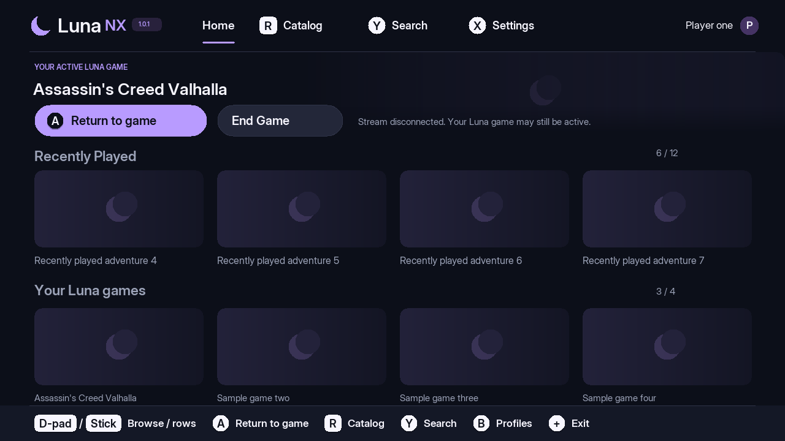

<p align="center"></p>

# LunaNX

**Amazon Luna streaming on Nintendo Switch homebrew.** LunaNX is an unofficial,
native client by **PostTenebrasSoftware**, with a controller-friendly launcher,
remembered sign-in, hardware video decoding, sound and gamepad input. No PC
companion is required.

**Production release: v1.0.1.**
[Download](https://github.com/Post-Tenebras-Software/LunaNX/releases/latest) ·
[Report a bug](https://github.com/Post-Tenebras-Software/LunaNX/issues) ·
[Build from source](tools/release/BUILDING.md)

## Requirements

- A Nintendo Switch with a working homebrew environment and SD card.
- Full application memory: launch hbmenu or Sphaira through **title takeover**,
  then launch LunaNX. Album/applet mode is not supported.
- An internet connection and an Amazon account with Luna available in your
  region. Subscription, purchase, publisher-account linking and game-access
  requirements still apply. LunaNX does not provide games or a subscription.
- A phone or browser for Amazon's initial device-code sign-in.

## Install or update

1. Download **`LunaNX-v1.0.1-switch.zip`** from the GitHub release. Source and
   symbol archives are for developers, not SD-card installation.
2. Extract it to the root of your SD card. The app belongs at
   **`/switch/LunaNX/LunaNX.nro`**.
3. Open hbmenu or Sphaira with full application memory and launch **LunaNX**.

For an update, replace the NRO and bundled documentation. Keep the existing
`/switch/LunaNX/` data files to retain sign-in and settings. Release checksums
are in `SHA256SUMS`; source and dependency notices accompany every release.

HB App Store listing is **prepared for review, not yet approved**. Until it is
listed, use GitHub releases or Sphaira's GitHub browser. In Sphaira, add
`Post-Tenebras-Software/LunaNX` as a GitHub repository and choose the **switch
install ZIP**. Do not install source or symbols. See [store distribution](docs/DISTRIBUTION.md).

## First launch

1. Start sign-in and follow the Amazon code instructions shown on the Switch.
   Enter the code at **https://www.amazon.com/code** on another device.
2. Select your Luna profile. Sign-in is saved encrypted for this Switch; you
   should not need a new device registration every launch. Amazon can still
   require sign-in again after revocation or expiry.
3. Browse Home, your Included catalog or Search. Open a game's page and select
   **Play**. Review and explicitly accept any game terms that are required.
4. If Luna queues the launch, LunaNX shows its reported position and wait time.

The Included catalog shows titles whose access Luna could verify for the
selected profile. **Show all** includes titles that may need additional access.
Publisher-account linking and unsupported account requirements must be completed
through Luna's website.

## Controls

Launcher prompts use **Switch button labels**. During a game, LunaNX uses
**Xbox button positions**, so the letters differ:

| Physical Switch button | Xbox input sent |
| --- | --- |
| B (bottom) | A |
| A (right) | B |
| Y (left) | X |
| X (top) | Y |

| Launcher action | Control |
| --- | --- |
| Browse/select | D-pad or left stick; A confirms; B goes back |
| Catalog / Search / Settings | R / Y / X from Home |
| Included / Show all | L in the catalog |
| Previous / next catalog page | ZL / ZR |
| Full game description | Y on a game page |
| Trailer / screenshots | ZL / ZR on a game page, when available |
| Manage profiles | Y on the profile-selection screen |
| Disconnect stream and return Home | **Hold Plus, then tap Capture**; configurable in Settings |
| Show/hide performance overlay | **Hold Minus + R for one second**; disabled if it conflicts with your return shortcut |
| Exit LunaNX from the launcher | Plus |

If Capture notifications are unavailable, the return shortcut falls back to
holding **Minus + Plus for two seconds**. Settings shows the effective shortcut.

## Return, end or switch games

The Home shortcut **disconnects the stream; it does not end the remote game**.
After returning, a row above Recently Played offers:

- **Return to game:** reconnect through fresh Luna permission and signaling.
  If Luna has already expired the session, normal launch behavior applies.
- **End Game:** confirm to end that remote session. Save progress in the game
  first; unsaved progress can be lost.

Selecting a different game asks for confirmation before ending the previous
session and starting the new one. A failed or ambiguous termination stops the
replacement launch and displays an error.

These controls remember the game **while LunaNX stays open**, for the profile
that launched it. Closing and reopening LunaNX clears active-game tracking;
saved sign-in, settings and Recently Played remain. This does not impose a
gameplay timer. LunaNX does not discover sessions left running by another
device or before the app reopened. If another session blocks a launch, end it
through Luna's own session controls. Closing a browser tab alone may leave a
remote game active.

## Video, network and settings

- **Decoder:** Auto uses NVDEC hardware decoding with software fallback.
- **Video modes:** 720p30 and 720p60 handheld; 1080p presets are available in TV
  mode. **Docked 1080p has not been hardware-tested.**
- **Bitrate ceiling:** Auto or a supported manual limit. A stronger connection
  may benefit from a higher limit, but Luna still controls the actual bitrate.
  Lower it if you see stalls or packet loss. No bitrate guarantees a given FPS.
- **Debug overlay:** requested mode/bitrate, decoder, decoded and presented FPS,
  measured video bitrate and processing/frame-pacing statistics.
- **Return shortcut:** record your preferred combination in Settings.
- **Remembered login:** Settings can forget sign-in and sign out locally.

Settings apply to the next game. LunaNX does not change CPU, GPU or memory
clocks; external clock tools operate independently.

## Features

- Native Home, per-profile Recently Played, Included/All catalog and search.
- Cached artwork, game pages, descriptions, screenshots and manual trailers.
- Native Amazon sign-in, encrypted sign-in memory and access-token refresh.
- Adult profile creation and name/avatar editing.
- Game terms confirmation, queue progress, loading screen and session controls.
- H.264/NVDEC video, Opus sound and controller forwarding.



*Offline UI preview with synthetic titles and placeholder covers. Live game
artwork loads from Luna for your signed-in profile.*

## Known limits and troubleshooting

Handheld 720p60 gameplay with audio/input, remembered login, profile changes,
game pages/trailers and session controls were tested on a physical Switch during
development. The standalone production build also passed the author's smoke
test, including the catalog-cover correction. Store installation and docked
1080p remain unverified. See
[validation](docs/VALIDATION.md) for the exact tested builds.

| Problem | What to check |
| --- | --- |
| App fails to start or runs out of memory | Use title takeover, not Album/applet mode. |
| Game cannot start | End other Luna sessions; verify the same game/profile works on Luna's website. Confirm access and publisher-account requirements. |
| Queue appears stuck | Luna controls capacity and queue order. LunaNX waits in the queue for up to two hours and follows the server's polling interval. This timeout does not limit gameplay once streaming starts. |
| No game sound | Check Switch volume/output; confirm the stream has started. |
| Video stutters | Try a lower bitrate or 720p30, then inspect the overlay. |
| No Return to game row | It appears after disconnecting a game launched during this app run. |
| Sign-in is requested again | Check whether sign-in was forgotten, revoked or rejected; keep the SD-card data files when updating. |

Parental-control/PIN editing, child/teen profile management, profile deletion
and arbitrary photo uploads are not implemented. Unknown or restricted account
flows remain blocked. Trailer playback supports selected Amazon-CDN MP4 media;
unsupported formats remain unavailable. Luna's unofficial API can change.

For a bug report, include the version, Switch/CFW versions, handheld/docked
mode, selected decoder/video/bitrate, overlay numbers and reproduction steps.
**Do not post Amazon tokens, saved login files, SDP, full HAR files or complete
authenticated requests/responses.** Sanitized nxlink status lines are useful.
See [SECURITY.md](SECURITY.md) for private reports.

## Source and contributions

This repository builds **only the production client**. It includes the patched
RTC/crypto sources, fonts, required dependency source archives and offline tests.
The earlier companion, browser captures, diagnostic applications and debug
release checkpoints are not part of this repository.

```sh
bash tools/release/build.sh
python3 tools/release/check.py --tests
python3 tools/release/package.py
```

See [BUILDING.md](tools/release/BUILDING.md) for devkitPro dependencies and
[CONTRIBUTING.md](CONTRIBUTING.md) before submitting changes.

## License, credits and affiliation

LunaNX's original code and branding assets are **GPL-3.0-or-later**.
Dependency terms are retained; see [LICENSE](LICENSE), [COPYRIGHT](COPYRIGHT)
and [THIRD_PARTY_NOTICES.md](THIRD_PARTY_NOTICES.md). Distribute the matching
source archive alongside the binary. Thanks to devkitPro/libnx, libdatachannel,
libjuice, usrsctp, libSRTP, Mbed TLS, FFmpeg, FreeType and the Inter font project.

Development is **mostly AI-generated, directed and hardware-tested by the
author**. AI assistance also covered documentation and the original vector
branding/store artwork.

LunaNX is independent and **not affiliated with or endorsed by Amazon,
Nintendo, EA or any other game publisher**. Amazon Luna and Nintendo Switch
names belong to their respective owners. No games, Amazon client bundles,
account data or downloaded game artwork are distributed with LunaNX.
